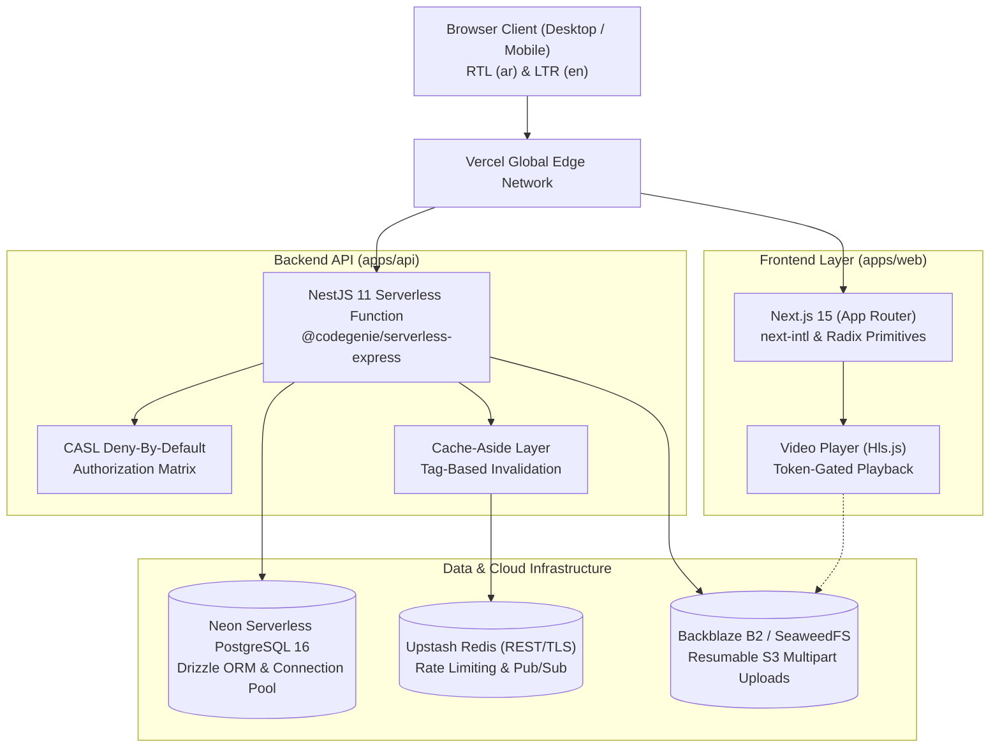

# Sage (سايج) — Scholarly Bilingual Course Platform

<div align="center">

**A classical bilingual (Arabic/English, RTL-first) course platform with protected video delivery, paper-ink aesthetics, and high-concurrency serverless architecture.**

[](https://www.typescriptlang.org/)
[](https://nextjs.org/)
[](https://nestjs.com/)
[-336791.svg)](https://neon.tech/)
[](https://upstash.com/)
[](LICENSE)

[Architecture](#-system-architecture) • [Key Features](#-key-features) • [Quick Start](#-quick-start) • [Seed Data](#-pre-seeded-demo-accounts) • [ADRs](docs/adr/)

</div>

---

## 🏛️ Philosophy & Design System

Sage is designed to feel like a quiet, scholarly study rather than a commercial sales funnel.

- **Paper & Ink Aesthetic:** Warm ivory paper canvas (`#fbf7ee`), deep navy ink typography (`#15233f`), sage green accents (`#44614a`), and warm amber highlights (`#e39b35`).
- **Bilingual & RTL-First:** 100% engineered with CSS logical properties (`ms-`, `me-`, `ps-`, `pe-`, `start-`, `end-`). Directional iconography automatically mirrors in Arabic (`rtl:-scale-x-100`) while media players, timecodes, and serial numbers stay LTR (`dir="ltr"`).
- **Scholarly Typography:** Classical **Amiri** Arabic serif paired with **EB Garamond** in English, supported by **IBM Plex Sans / IBM Plex Sans Arabic** for interface controls and **IBM Plex Mono** for code and serial numbers.

---

## 📐 System Architecture



---

## 🌟 Key Features

### 1. Resumable Media Pipeline & Protected HLS Video
- Resumable S3 multipart uploads in the Course Studio.
- Automatic HLS transcoding to adaptive bitrates (`360p`, `720p`, `1080p`).
- Token-gated playback: short-lived, cryptographically signed playback tokens prevent hotlinking and unauthorized segment downloads.

### 2. Arabic-Normalized PostgreSQL Full-Text Search
- Custom application-level Arabic text normalizer (removes tashkeel and tatweel; normalizes alef variants `أ/إ/آ` to `ا`, alef maqsura `ى` to `ي`, and ta marbuta `ة` to `ه`).
- Indexed using `to_tsvector('simple', search_text)` combined with `pg_trgm` GIN indexes for typo tolerance.

### 3. Concurrency-Safe Enrollment & Anti-Leakage Quizzes
- Atomic, row-locked coupon redemptions (`SELECT FOR UPDATE`) tested under 20 concurrent threads.
- Progress tracking heartbeats (saved every 15 seconds; auto-completes at $\ge 90\%$ watch duration).
- Server-side quiz grading with zero answer leakage to the client bundle.

### 4. Serverless-Compatible Real-Time Streaming (SSE)
- Server-Sent Events (`GET /api/realtime/events`) with 25-second keepalive pings over HTTP/2.
- Lesson Q&A discussion threads with live instructor verified badges and notification center updates.
- In-memory ring buffer with `Last-Event-ID` playback recovery across network drops.

### 5. Verifiable Bilingual Certificates
- Awarded upon $100\%$ course completion with unique human-readable serials (`SAGE-YYYY-XXXXXX`).
- Deterministic vector SVG QR code pointing to public verification (`/[locale]/verify/[serial]`).
- Print-styled HTML/SVG formatting for browser vector PDF generation (`Ctrl+P` / `window.print()`).

### 6. Pluggable Payments & Idempotent Webhooks
- Modular `PaymentProvider` interface with a built-in `FakePaymentProvider` for realistic local/demo sandbox testing.
- HMAC SHA-256 webhook signature verification.
- Transactional idempotency check ensuring duplicate webhook deliveries grant enrollment exactly once.

---

## 📁 Monorepo Structure

```
├── apps/
│   ├── api/                 # NestJS 11 backend API
│   │   ├── api/index.ts     # Vercel Serverless Function entrypoint
│   │   ├── src/             # Modules: auth, courses, media, payments, etc.
│   │   ├── test/            # Integration & authorization matrix suites
│   │   └── drizzle/         # SQL migration files
│   └── web/                 # Next.js 15 App Router web application
│       ├── messages/        # Bilingual i18n dictionaries (ar.json, en.json)
│       └── src/             # Components, pages, and hooks
├── packages/
│   └── shared/              # Shared Zod schemas, DTOs, and constants
├── docs/
│   ├── adr/                 # Architecture Decision Records (ADR 0001 - 0009)
│   └── deploy-runbook.md    # Production Vercel & Neon deployment guide
└── scripts/
    └── backup-db.ps1        # Automated PostgreSQL backup utility
```

---

## 🚀 Quick Start

### 1. Prerequisites
- Node.js 22+
- pnpm 9+

### 2. Installation
```bash
git clone https://github.com/nooremeel/Sage.git
cd Sage
pnpm install
```

### 3. Environment Setup
Copy the example configuration:
```bash
cp .env.example .env
```
Ensure your `DATABASE_URL` (Neon PostgreSQL) and `UPSTASH_REDIS_REST_URL` are populated.

### 4. Database Migrations & Seeding
```bash
# Apply migrations to database
pnpm --filter @sage/api db:migrate

# Seed scholarly demo courses, categories, reviews, and test accounts
pnpm --filter @sage/api db:seed
```

### 5. Run Development Servers
```bash
pnpm dev
```
- Web Application: `http://localhost:3000`
- API Server: `http://localhost:4000/api`
- Swagger OpenAPI: `http://localhost:4000/api/docs`

---

## 👥 Pre-Seeded Demo Accounts

All seeded accounts use password: `Password123!`

| Role | Email | Locale | Specialties |
|---|---|---|---|
| **Admin** | `admin@sage.local` | `en` | Platform governance & review queues |
| **Instructor** | `nour@sage.local` | `ar` | Software Engineering & Cloud Systems |
| **Instructor** | `tariq@sage.local` | `ar` | Classical Arabic Calligraphy & Illumination |
| **Instructor** | `sarah@sage.local` | `en` | Digital Product Strategy |
| **Student** | `student@sage.local` | `ar` | Enrolled in Thuluth Calligraphy (Certificate Holder) |

### Sample Verifiable Certificate
- Public URL: `/en/verify/SAGE-2026-ALPHA1` or `/ar/verify/SAGE-2026-ALPHA1`
- Student: `student@sage.local`
- Course: *Classical Arabic Calligraphy: The Geometry of Thuluth*

### Active Promotional Coupons
- `SAGE100`: $100\%$ discount on any course.
- `SCHOLAR50`: $50\%$ discount.
- `WELCOME20`: $\$20$ fixed discount.

---

## 🧪 Testing & Quality Gates

```bash
# Run full monorepo test suite (115 tests)
pnpm -r test

# Run strict TypeScript typecheck
pnpm -r typecheck

# Check 100% key parity between ar.json and en.json
pnpm --filter @sage/web i18n:check

# Run ESLint (enforces CSS logical properties)
pnpm -r lint
```

---

## 📜 Architecture Decision Records (ADRs)

Key architectural decisions are documented in [`docs/adr/`](docs/adr/):
- **ADR 0001:** Bilingual routing and Next.js / NestJS monorepo architecture
- **ADR 0002:** Dual-stack awareness: Neon Serverless PostgreSQL with Drizzle ORM
- **ADR 0003:** Resumable multipart video pipeline with token-gated HLS delivery
- **ADR 0004:** Normalized Arabic full-text search and Upstash cache-aside
- **ADR 0005:** Concurrency-safe coupon redemptions & server-side quiz grading
- **ADR 0006:** Serverless-compatible real-time streaming (SSE) & lesson Q&A
- **ADR 0007:** Verifiable bilingual certificates & course reviews
- **ADR 0008:** Pluggable payment providers & idempotent webhook state machine
- **ADR 0009:** Production hardening, security headers, and Vercel serverless deployment

---

## 📄 License

MIT © 2026 Nour Emil & Sage Contributors.
